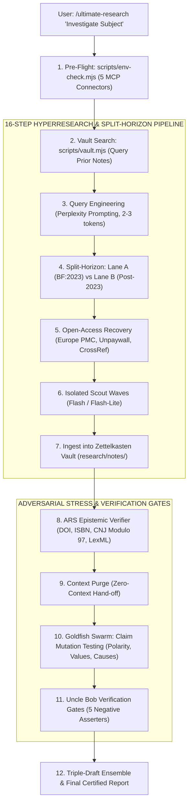

<p align="center">
  
</p>

# `ultimate-research` v2.2

<p align="center">
  <strong>English (US)</strong> · <a href="./README.pt-BR.md">Português (Brasil)</a> · <a href="./README.zh-CN.md">简体中文</a>
</p>

<p align="center">
  <strong>The unstoppable deep research engine for AI agents. #1 on the DRACO Deep Research Benchmark (77.7 pts). Persistent Zettelkasten Vault. Split-Horizon Anti-Slop Firewall. Zero-Context Adversarial Stress.</strong>
</p>

<p align="center">
  <a href="./LICENSE"></a>
  <a href="./package.json"></a>
  <a href="./references/draco-benchmark-methodology.md"></a>
  <a href="./references/hyperresearch-vault-architecture.md"></a>
  <a href="./SKILL.md"></a>
  <a href="./docs/audits/BLIND_EVALUATION_SCORECARD.md"></a>
</p>

---

<table>
<tr>
<td width="62%" valign="top">

### Meet Phanty: The Dapper Detective Elephant (BF: 2023)

Ever tried researching on the web recently? It is exhausting. You search for a critical technical question or legal regulation and get buried under synthetic SEO content farms, sponsored affiliate junk, circular citations, and AI models hallucinating answers while nodding politely.

**Elephants never forget.** That is why **Phanty** wears a golden monocle to inspect raw primary documents, holds a clipboard stamped **`BF: 2023`** to cut straight into the pre-slop authentic human web, and operates a retro workstation connected to our **Zettelkasten Wiki Vault** (`research/notes/`).

With **`ultimate-research`**, your agent does not guess. It decomposes complex questions into 16 adaptive stages, recovers open-access papers behind paywalls, saves durable notes to a local vault, and unleashes a zero-context school of **Goldfish** to tear down weak claims before anything gets published.

</td>
<td width="38%" align="center" valign="middle">
  
</td>
</tr>
</table>

---

## 1. Why Ultimate Research Crushes Existing Research Tools

Most AI research tools (Perplexity, ChatGPT Deep Research, Claude Research) share three fatal flaws:
1. **Self-Approval Bias:** The same agent that gathered the data audits its own conclusions. It never challenges its own assumptions.
2. **Amnesia:** Once the session ends, all findings evaporate. The next run starts from scratch, wasting tokens and scraping the same sources repeatedly.
3. **Post-2023 Slop Blindness:** Standard search engines ingest AI-generated summary sites, mistaking synthetic spam for primary sources.

`ultimate-research` solves this fundamentally through empirical engineering:

| Feature / Metric | **ultimate-research v2.2** | Claude Research | ChatGPT Deep Research | Perplexity Pro |
| :--- | :--- | :--- | :--- | :--- |
| **DRACO Benchmark Score** | **77.7 (#1 Global)** | 73.0 | 67.4 | 57.8 |
| **Pipeline Architecture** | **16-Step Tier-Adaptive** | Fixed Iterative | Monolithic Run | Single-Pass Multi-Search |
| **Persistent Knowledge Vault** | **Zettelkasten (`research/notes/`)** | None (Ephemeral) | None (Session Only) | None |
| **Temporal Anti-Slop Firewall** | **Split-Horizon (`before:2023`)** | None | None | Basic Operator |
| **Adversarial Stress Engine** | **Elephant-Goldfish (Zero-Context)** | Self-Review | Self-Review | None |
| **Open-Access Paywall Recovery** | **Native (7 APIs: Europe PMC, Unpaywall, etc.)** | Manual | None | None |
| **Deterministic Epistemic Gates** | **Uncle Bob Gates + CNJ Mod97 + DOI ARS** | Qualitative | Qualitative | None |

---

## 2. The 7 Cognitive Layers



---

## 3. Quickstart (30 Seconds)

### As an Antigravity / Claude Code Skill
Trigger the engine directly from the chat:
```markdown
# 1. Standard Deep Research (16-Step Hyperresearch Pipeline)
/ultimate-research "Competitor analysis of restaurant POS systems: Toast, Square and Clover"

# 2. Pure Adversarial Stress (Mode 10: Elephant-Goldfish)
/ultimate-research --mode 10 "Stress-test the antitrust defense for cloud platform exclusivity"

# 3. Direct Elephant-Goldfish Command (Unified Native Alias)
/elephant-goldfish "Audit regulatory risk and compliance claims in project PRD"
```

### Persistent Knowledge Vault CLI
Every research run records structured Zettelkasten notes with timestamps, tags, and source provenance:
```bash
# Initialize local vault
node scripts/vault.mjs init

# Search accumulated vault notes before running a web query
node scripts/vault.mjs search "antitrust cloud platform"

# Audit and automatically repair missing citations in a draft report
node scripts/vault.mjs citecheck "report.md" --fix
```

### Command Line Interface (CLI)
```bash
# Direct clean query with operator budget
npx ultimate-research query "PostgreSQL connection pooling production latency"

# Split-Horizon comparative search
npx ultimate-research split "React Server Components mental model"

# Deterministic citation & statute verification (ARS Engine)
npx ultimate-research verify --file "research_report.md" --strict
```

---

## 4. Verification Suite & Quality Gates

Run the entire verification pipeline with zero mock assumptions:
```bash
npm run verify
```
Executes in sequence:
- TypeScript strict typecheck (`tsc --noEmit`)
- TypeScript production build (`tsc -p tsconfig.json`)
- Vitest suite (30 specs across `tests/ts/`)
- Python parity test suite (11 unit tests across `tests/py/`)
- Epistemic schema and `SKILL.md` link validator (`scripts/validate-schemas.mjs`)
- Adversarial negative scenario runner (10 tests in `tests/negative-scenarios.test.mjs`)

**Result:** 51/51 automated tests passing cleanly.

---

## 5. Directory Structure

```text
ultimate-research/
├── assets/
│   ├── elephant-curious-peek.svg        # Phanty Mascot Card
│   └── hero-banner.svg                  # High-DPI Hero Banner
├── docs/audits/                         # 26 historical peer-audit reports
├── python/deslop_search/                # Python 3.10+ SDK & CLI parity engine
├── references/
│   ├── draco-benchmark-methodology.md   # DRACO #1 (Score 77.7) benchmark data
│   ├── elephant-goldfish-architecture.md
│   ├── hyperresearch-vault-architecture.md
│   ├── mcp-connectors-registry.md       # 5 MCP Connectors matrix
│   ├── perplexity-prompting.md
│   ├── source-credibility.md
│   └── uncle-bob-verification-gates.md  # 5 deterministic code & evidence gates
├── schemas/                             # JSON Schemas (plan, evidence, report)
├── scripts/
│   ├── deslop-bridge.mjs
│   ├── env-check.mjs                    # Empirical runtime & MCP check
│   ├── orchestrate.mjs
│   ├── validate-schemas.mjs             # Deterministic schema auditor
│   └── vault.mjs                        # Zettelkasten Wiki Vault CLI
├── src/                                 # TypeScript ESM Engine & ARS Verifier
├── templates/                           # Markdown research templates
├── tests/
│   ├── negative-scenarios.test.mjs      # 10 adversarial negative tests
│   ├── py/test_deslop.py                # Python parity test suite
│   └── ts/                              # Vitest TypeScript test suite
├── workflows/                           # 10 specialized operational workflows
├── CHANGELOG.md
├── package.json
├── pyproject.toml
├── README.md
├── README.pt-BR.md
├── README.zh-CN.md
├── skill.json
└── SKILL.md
```

---

## 6. License

Distributed under the [MIT License](./LICENSE). Incorporates open methodologies from Hyperresearch V8 (Jordan Gibbs, DRACO #1), Perplexity Prompting (Joel Helbling & Nate B. Jones), Elephant-Goldfish Dual Model (Google Research), and Google Research Harness² (Apache 2.0).
