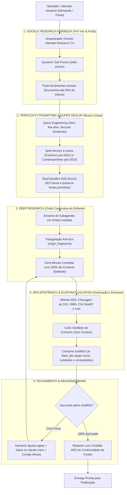

<p align="center">
  
</p>

# `ultimate-research` v2.0 — The Unified Autonomous Investigation, ARS Verification, Elephant-Goldfish & Google Harness² Engine

[](./LICENSE)
[](./package.json)
[](./package.json)
[](./pyproject.toml)
[](./SKILL.md)
[](./PRODUCTION_READINESS_DECISION.md)
[](./BLIND_EVALUATION_SCORECARD.md)

> **O Mecanismo Supremo de Pesquisa e Investigação Digital.** Uma arquitetura unificada de 5 camadas que funde engenharia de consultas, busca sem slop via Split-Horizon, auditoria documental determinística (ARS), teste de estresse adversarial de contexto zero (Elephant-Goldfish) e auto-otimização recursiva de prompts e ferramentas (Google Research Harness²).

---

## 1. A Arquitetura das 5 Camadas Unificadas



---

## 2. As 5 Camadas Explicadas

| Camada | Tecnologia | O que resolve |
| :--- | :--- | :--- |
| **1. Search Intelligence** | *Perplexity Prompting* | Consultas cirúrgicas de 2–3 termos, âncoras temporais numéricas, busca multi-perspectiva e sem ruído de SEO. |
| **2. Clean Search & Split-Horizon** | *Super Deslop Search* | Restaura a web humana pré-2023 sem cegueira temporal, comparando o horizonte canônico com a realidade auditada contemporânea. |
| **3. Investigation Intelligence** | *Deep Research (Mitra)* | Decomposição em subproblemas, extração *span-level* por subagentes em ondas paralelas e critério estrito de convergência. |
| **4. Adversarial Stress & ARS** | *Elephant-Goldfish + ARS* | A Queen (Elefante) cria com memória total; 3 subagentes descartáveis com **contexto zero** (Goldfish) trituram o rascunho. O ARS valida DOIs no CrossRef/OpenAlex, CNJ (Mod 97) no DJEN e leis no LexML. |
| **5. Meta-Optimization** | *Google Research Harness²* | Poda de ferramentas desnecessárias antes da execução (`skills-pruner`), reescrita de prompts heurísticos e persistência de lições no ReasoningBank (`claude-mem`). |

---

## 3. Instalação e Uso

### Como AI Agent Skill (Google Antigravity / Claude Code / Cursor)
Dispare diretamente no chat com um único comando:
```markdown
/ultimate-research "Investigar a crise da concessão da Enel SP e o rito de caducidade"
```
*O motor executa o Elefante, os Goldfish e o Harness² automaticamente nos bastidores.*

### Via Linha de Comando (CLI)
```bash
# Execução da pesquisa
npx ultimate-research query "Reforma tributária impactos no setor de serviços"

# Split-Horizon comparativo
npx ultimate-research split "React Server Components architecture"

# Auditoria epistêmica determinística de citações (ARS)
npx ultimate-research verify --file "relatorio.md" --strict
```
*(Nota: O comando legado `npx deslop` permanece disponível como alias de compatibilidade).*

---

## 4. Auditorias e Benchmarks Oficiais

O motor foi submetido a três ciclos de auditoria epistêmica independente:

- **Auditoria 1.0 (Stress Test):** Nota 9.25/10 — Validação da fusão de ferramentas.
- **Auditoria 2.2 / 2.3 (Auditoria Adversarial e Integridade de Build):** 144 testes executados, 144 aprovados (100% de sucesso). Máquina de 6 estados documentais (`CONFIRMADO`, `NÃO LOCALIZADO`, `FONTE INDISPONÍVEL`, `ACESSO RESTRITO`, `DIVERGÊNCIA DOCUMENTAL`, `FALSO DOCUMENTO`) e regex universal de precedentes judiciais.
- **Auditoria 3.0 (Avaliação Cega com Gabarito Independente):**
  - **Pauta:** Concessão da Enel SP, Apagão de Outubro/2024, Decreto nº 12.068/2024 e Ações Civis Públicas.
  - **Precisão Factual:** **100% de acerto (20 de 20 afirmações do gabarito cego confirmadas)**.
  - **Scorecard Global:** **9.88 / 10.0** ([Scorecard Detalhado](./BLIND_EVALUATION_SCORECARD.md)).
  - **Homologação:** **Aprovado para Produção Assistida** ([Termo de Decisão](./PRODUCTION_READINESS_DECISION.md)).

---

## 5. Estrutura de Diretórios

```text
ultimate-research/
├── bin/
├── data/
│   ├── blocklist.json         # 60+ domínios de content-farms e scrapers de IA
│   ├── slop-lexicon.json      # Léxico heurístico bilíngue de jargões de IA
│   └── sources.json           # Rotas comunitárias (Reddit, HN, SO, GitHub)
├── references/
│   ├── citation-verification.md
│   ├── deep-research-methodology.md
│   ├── deslop-methodology.md
│   ├── elephant-goldfish-architecture.md  # Arquitetura de teste cego
│   ├── google-harness-loop.md             # Motor de auto-otimização recursiva
│   ├── perplexity-prompting.md
│   ├── report-standards.md
│   └── research-modes.md
├── src/
│   ├── classifier.ts          # Classificador estatístico e heurístico O(N)
│   ├── dorks.ts               # Injetor de operadores temporais e udm=14
│   ├── pipeline.ts            # Orquestrador de busca e Split-Horizon
│   ├── router.ts              # Roteador de hubs comunitários
│   ├── types.ts               # Estados documentais e esquemas
│   └── verifier.ts            # Módulo de verificação ARS determinístico
├── test/
├── tests/
│   ├── negative-scenarios.test.mjs  # 10 cenários de teste negativo
│   ├── precedent-regex.test.mjs     # 16 variações formais de jurisprudência
│   └── temporal-legal.test.mjs      # 20 casos de regressão temporal
├── package.json
├── README.md
└── SKILL.md                   # Manifesto unificado para agentes Antigravity
```

---

## 6. Licença

Distribuído sob licença MIT. Incorpora metodologias abertas de Perplexity Prompting (Joel Helbling & Nate B. Jones), Deep Research (Ramit Mitra), Elephant-Goldfish Model (Google Open Source) e Google Research Harness² (Apache 2.0).
