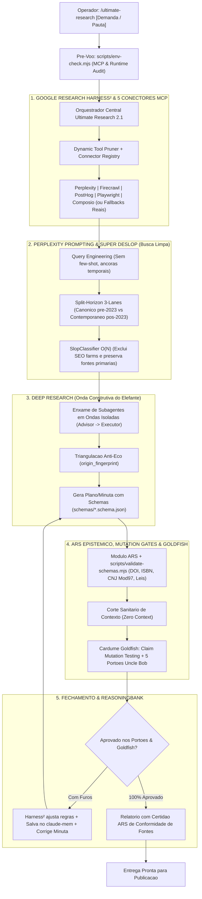

<p align="center">
  
</p>

# `ultimate-research` v2.1: The Unified Autonomous Research, 5 MCP Connectors & Mutation Gates Engine

[](./LICENSE)
[](./package.json)
[](./package.json)
[](./pyproject.toml)
[](./SKILL.md)
[](./docs/audits/PRODUCTION_READINESS_DECISION.md)
[](./docs/audits/BLIND_EVALUATION_SCORECARD.md)

> **O Mecanismo Unificado de Pesquisa e Investigacao Digital (v2.1.0).** Funde engenharia de consultas, busca sem slop via Split-Horizon, auditoria documental deterministica (ARS), contratos JSON Schema (`schemas/`), Auditoria Pre-Voo de 5 Conectores MCP (`scripts/env-check.mjs`), estresse adversarial de contexto zero com **Claim Mutation Testing** (Elephant-Goldfish + Uncle Bob Gates) e auto-otimizacao recursiva (Google Research Harness²).

---

## 1. Arquitetura das 5 Camadas Unificadas



---

## 2. As 5 Camadas e Novidades da v2.1.0

| Camada | Tecnologia | O que resolve |
| :--- | :--- | :--- |
| **1. Search Intelligence** | *Perplexity Prompting* | Consultas cirurgicas de 2-3 termos, ancoras temporais numericas, busca multi-perspectiva e roteamento sem ruido de SEO. |
| **2. Clean Search & Split-Horizon** | *Super Deslop Search* | Restaura a web humana pre-2023 sem cegueira temporal, comparando o horizonte canonico com a realidade auditada contemporanea. |
| **3. Investigation Intelligence** | *Deep Research + Schemas* | Decomposicao em subproblemas, extracao *span-level* em ondas paralelas, contratos JSON (`schemas/`) e convergencia matematica. |
| **4. Adversarial Stress, Mutation & ARS** | *Elephant-Goldfish + Uncle Bob Gates + ARS* | Cardume Goldfish (**contexto zero**) aplica **Claim Mutation Testing** (inversao de polaridade, perturbacao numerica/temporal e inversao causal) e os 5 portoes de codigo limpo; o ARS valida DOIs no CrossRef/OpenAlex, CNJ (Mod 97) no DJEN e leis no LexML. |
| **5. Meta-Optimization & 5 MCP Connectors** | *Google Research Harness² + Env Audit* | Auditoria pre-voo via `scripts/env-check.mjs`, registro honesto dos 5 conectores MCP (`Perplexity`, `Firecrawl`, `PostHog`, `Playwright`, `Composio`) em `references/mcp-connectors-registry.md`, poda de tools e ReasoningBank (`claude-mem`). |

### Destaques da Release v2.1.0
- **Auditoria Empirica de Ambiente (`scripts/env-check.mjs`):** Detecta servidores MCP realmente configurados em `.gemini` (nunca simula conectores ausentes), valida runtimes Node/Python e verifica os exports do SDK/ARS antes de iniciar a pesquisa.
- **Registro dos 5 Conectores MCP (`references/mcp-connectors-registry.md`):** Mapeia **Perplexity, Firecrawl, PostHog, Playwright e Composio** com prioridade por modo, isolamento contra Prompt Injection e fallbacks nativos verificaveis.
- **Uncle Bob Verification Gates & Claim Mutation Testing (`references/uncle-bob-verification-gates.md`):** Converte criterios qualitativos em 5 metricas objetivas de engenharia (`Coverage Delta`, `Dependency DAG`, `Cyclomatic Complexity`, `Module Size`, `Mutation Testing`) e exige mutacao adversarial de alegacoes antes do selo `[VERIFICADA]`.
- **Contratos JSON Schema & Auditor Epistemico (`schemas/` + `scripts/validate-schemas.mjs`):** Valida `research-plan.schema.json`, `evidence.schema.json` e `report.schema.json`, bloqueia `VERIFICADA` sem `entailment_checked === true`, deduplica re-publicacoes por `origin_fingerprint` e audita links internos e frontmatter de `SKILL.md`.

---

## 3. Instalacao e Uso

### Como AI Agent Skill (Google Antigravity / Claude Code / Cursor)
Dispare diretamente no chat com um unico comando:
```markdown
/ultimate-research "Investigar a crise da concessao da Enel SP e o rito de caducidade"
```

### Scripts de Orquestracao e Validacao v2.1.0
```bash
# 1. Auditoria empirica pre-voo (MCPs instalados, runtimes e SDK Super Deslop)
node scripts/env-check.mjs

# 2. Analise de intencao, modo (MODE 1..8) e compilacao do plano de pesquisa
node scripts/orchestrate.mjs "Sua demanda de pesquisa"

# 3. Validacao estrutural da skill, links internos e contratos JSON
node scripts/validate-schemas.mjs skill .

# 4. Execucao direta via Bridge Unificada
node scripts/deslop-bridge.mjs status
```

### Via Linha de Comando (CLI)
```bash
# Execucao da pesquisa
npx ultimate-research query "Reforma tributaria impactos no setor de servicos"

# Split-Horizon comparativo
npx ultimate-research split "React Server Components architecture"

# Auditoria epistemica deterministica de citacoes (ARS)
npx ultimate-research verify --file "relatorio.md" --strict
```
*(Nota: O comando legado `npx deslop` permanece disponivel como alias de compatibilidade).*

---

## 4. Auditorias, Testes e Benchmarks Oficiais

- **Auditoria 1.0 (Stress Test):** Nota 9.25/10 - Validacao da fusao de ferramentas ([Relatorio](./docs/audits/STRESS_TEST_REPORT.md)).
- **Auditoria 2.2 / 2.3 (Auditoria Adversarial e Integridade de Build):** Validacao da maquina de 6 estados documentais (`CONFIRMADO`, `NAO LOCALIZADO`, `FONTE INDISPONIVEL`, `ACESSO RESTRITO`, `DIVERGENCIA DOCUMENTAL`, `FALSO DOCUMENTO`), regex universal de precedentes judiciais e testes negativos ([Relatorio](./docs/audits/INSTALLED_BUILD_INTEGRITY_REPORT.md)).
- **Auditoria 3.0 (Avaliacao Cega com Gabarito Independente):**
  - **Pauta:** Concessao da Enel SP, Apagao de Outubro/2024, Decreto nº 12.068/2024 e Acoes Civis Publicas.
  - **Precisao Factual:** **100% de acerto (20 de 20 afirmacoes do gabarito cego confirmadas)**.
  - **Scorecard Global:** **9.88 / 10.0** ([Scorecard Detalhado](./docs/audits/BLIND_EVALUATION_SCORECARD.md)).
  - **Homologacao:** **Aprovado para Producao Assistida** ([Termo de Decisao](./docs/audits/PRODUCTION_READINESS_DECISION.md)).

### Validacao Automatizada (CI & Local)
```bash
npm run verify
```
Executa sequencialmente: `tsc --noEmit`, `tsc -p tsconfig.json`, Vitest (`tests/ts/*.test.ts`), Python `unittest` (`tests/py/test_*.py`), `node scripts/validate-schemas.mjs` e `node --test tests/negative-scenarios.test.mjs`.

---

## 5. Estrutura de Diretorios

```text
ultimate-research/
├── .github/workflows/ci.yml        # Pipeline CI completa (Node 22 + Python 3.12)
├── data/                           # Blocklist, sources e slop lexicon sincronizados
├── docs/audits/                    # 26 relatorios e matrizes historicas de auditoria
├── python/deslop_search/           # Biblioteca e CLI Python (paridade estrita)
├── references/
│   ├── citation-verification.md
│   ├── deep-research-methodology.md
│   ├── deslop-methodology.md
│   ├── elephant-goldfish-architecture.md
│   ├── google-harness-loop.md
│   ├── mcp-connectors-registry.md         # Matriz dos 5 conectores MCP + fallbacks
│   ├── perplexity-prompting.md
│   ├── report-standards.md
│   ├── research-modes.md
│   ├── source-credibility.md
│   ├── temporal-research.md
│   └── uncle-bob-verification-gates.md    # Portoes objetivos e Claim Mutation Testing
├── schemas/
│   ├── evidence.schema.json
│   ├── report.schema.json
│   └── research-plan.schema.json
├── scripts/
│   ├── deslop-bridge.mjs
│   ├── env-check.mjs
│   ├── orchestrate.mjs
│   └── validate-schemas.mjs
├── src/                            # Motor TypeScript ESM e verificador ARS
├── templates/                      # Templates Markdown para planos, matrizes e relatorios
├── tests/
│   ├── negative-scenarios.test.mjs # 10 cenarios adversariais (node:test)
│   ├── py/test_deslop.py           # Suite de paridade Python
│   └── ts/                         # Suites Vitest consolidadas (deslop + verifier)
├── workflows/                      # 9 workflows especializados sob demanda
├── CHANGELOG.md
├── package.json
├── pyproject.toml
├── README.md
├── skill.json
└── SKILL.md
```

---

## 6. Licenca

Distribuido sob licenca MIT. Incorpora metodologias abertas de Perplexity Prompting (Joel Helbling & Nate B. Jones), Deep Research (Ramit Mitra), Elephant-Goldfish Model (Google Open Source) e Google Research Harness² (Apache 2.0).
