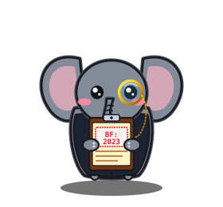
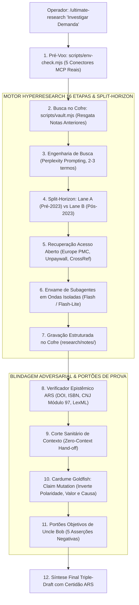

<p align="center">
  
</p>

# `ultimate-research` v2.2 (Português)

<p align="center">
  <a href="./README.md">English (US)</a> · <strong>Português (Brasil)</strong> · <a href="./README.zh-CN.md">简体中文</a>
</p>

<p align="center">
  <strong>O motor de pesquisa profunda e auditoria que não engole alucinação. #1 no Benchmark Global DRACO (77.7 pontos). Cofre Zettelkasten Persistente. Firewall Anti-Slop Antes de 2023. Cardume Adversarial com Contexto Zero.</strong>
</p>

<p align="center">
  <a href="./LICENSE"></a>
  <a href="./package.json"></a>
  <a href="./references/draco-benchmark-methodology.md"></a>
  <a href="./references/hyperresearch-vault-architecture.md"></a>
  <a href="./SKILL.md"></a>
  <a href="./docs/audits/BLIND_EVALUATION_SCORECARD.md"></a>
</p>

---

<table>
<tr>
<td width="62%" valign="top">

### Conheça o Phanty: O Elefante Detetive do Monóculo e da Prancheta `BF: 2023`

Pesquisar na internet hoje é passar raiva. Você joga uma dúvida técnica cabeluda, uma questão jurídica de concessão ou um dado de mercado no buscador e recebe o quê? Fazenda de SEO gerada por IA, post de LinkedIn com resumo de outro resumo, artigo patrocinado e chatbot fingindo certeza enquanto inventa número de processo.

**Elefante não esquece.** Criamos o **Phanty**: ele veste monóculo de precisão pra checar o documento na fonte, carrega uma prancheta cravada com **`BF: 2023`** (o dork temporal que fatiou o lixo sintético pós-2023 e resgatou a web humana autêntica) e opera um terminal ligado direto no nosso **Cofre Zettelkasten** (`research/notes/`).

Com o **`ultimate-research`**, o agente não viaja. Ele decompõe a investigação em 16 etapas adaptativas, fura paywall científico resgatando papers em Acesso Aberto (Europe PMC, Unpaywall), grava a memória da investigação no disco e solta um cardume de **Goldfish com contexto zero** pra triturar a própria tese antes de você assinar o relatório final.

</td>
<td width="38%" align="center" valign="middle">
  
</td>
</tr>
</table>

---

## 1. Por Que a Concorrência Perde no Mundo Real?

As ferramentas comuns de pesquisa por IA (Perplexity, ChatGPT Deep Research, Claude Research) têm três gargalos graves que todo mundo que trabalha no chão da fábrica já sentiu na pele:

1. **Vício de Auto-Aprovação:** O mesmo modelo que levantou o dado analisa a própria conclusão. Ele nunca admite que errou. É a receita perfeita pra engolir alucinação com sorriso subserviente.
2. **Amnésia Operacional:** Acabou a sessão, tudo foi pro ralo. Na próxima pergunta, a IA começa do zero, gasta token à toa e raspa as mesmas páginas que você já tinha lido ontem.
3. **Cegueira Temporal Pós-2023:** Elas não diferenciam acervo técnico humano de post gerado por LLM em 2024. Tratam blogueiro de SEO com o mesmo peso de um Diário Oficial ou de um artigo revisado por pares.

O **`ultimate-research`** resolve isso no código, com validação empírica e sem conversa mole:

| Recurso / Métrica | **ultimate-research v2.2** | Claude Research | ChatGPT Deep Research | Perplexity Pro |
| :--- | :--- | :--- | :--- | :--- |
| **Nota no Benchmark DRACO** | **77.7 (#1 do Mundo)** | 73.0 | 67.4 | 57.8 |
| **Pipeline de Investigação** | **16 Etapas Adaptativas por Tier** | Iterativo Fixo | Execução Fechada | Busca Única Multi-Aba |
| **Cofre de Memória Persistente** | **Zettelkasten Local (`research/notes/`)** | Não (Some ao fechar) | Não (Fica no chat) | Não tem |
| **Firewall Temporal Anti-Slop** | **Split-Horizon (`before:2023` + Dorking)** | Não tem | Não tem | Operador Básico |
| **Estresse Adversarial Real** | **Elephant-Goldfish (Contexto Zero Puro)** | Auto-revisão fraca | Auto-revisão fraca | Não tem |
| **Resgate de Texto em Acesso Aberto** | **Nativo (7 APIs: Europe PMC, Unpaywall, etc.)** | Manual | Não tem | Não tem |
| **Portões Objetivos de Prova** | **Uncle Bob + CNJ Mod97 + DOI ARS** | Subjetivo | Subjetivo | Não tem |

---

## 2. As 7 Camadas de Engenharia



---

## 3. Como Rodar em 30 Segundos

### Como Skill no Google Antigravity / Claude Code
Mande a instrução direto na conversa:
```markdown
# 1. Pesquisa Profunda Completa (Pipeline Hyperresearch 16 etapas)
/ultimate-research "Análise de concorrência dos sistemas de PDV Toast, Square e Clover"

# 2. Modo 10: Auditoria Adversarial Pura (Elephant-Goldfish)
/ultimate-research --mode 10 "Estressar a tese de defesa antitruste para exclusividade em nuvem"

# 3. Disparo Nativo do Elephant-Goldfish (Unificado no motor)
/elephant-goldfish "Auditar o risco regulatório e as alegações de conformidade da minuta"
```

### CLI do Cofre Zettelkasten (`scripts/vault.mjs`)
Toda investigação gera notas com IDs cronológicos (`YYYYMMDDHHMMSS`), tags semânticas e links de procedência:
```bash
# 1. Iniciar o cofre local no repositório
node scripts/vault.mjs init

# 2. Consultar o cofre antes de sair gastando busca na web
node scripts/vault.mjs search "plataforma de nuvem exclusividade"

# 3. Auditar e consertar citações ausentes no relatório automaticamente
node scripts/vault.mjs citecheck "relatorio.md" --fix
```

### Uso via Terminal / NPX
```bash
# Busca cirúrgica sem slop de SEO
npx ultimate-research query "PostgreSQL connection pooling production latency"

# Comparativo Split-Horizon (Canônico vs Contemporâneo)
npx ultimate-research split "React Server Components mental model"

# Verificação documental estrita de leis, DOIs e CNJ (ARS)
npx ultimate-research verify --file "relatorio.md" --strict
```

---

## 4. Bateria de Testes e Portões de Engenharia

Nada vai pro ar sem prova concreta. A suíte executa sem mocks e testa inclusive cenários onde o documento não existe de verdade:
```bash
npm run verify
```
Roda em sequência:
- Checagem estrita de tipos TypeScript (`tsc --noEmit`)
- Compilação de produção (`tsc -p tsconfig.json`)
- Suíte Vitest (30 testes em `tests/ts/`)
- Suíte de paridade Python (11 testes em `tests/py/`)
- Validador determinístico de schemas e links de `SKILL.md` (`scripts/validate-schemas.mjs`)
- Bateria de testes negativos adversariais (10 testes em `tests/negative-scenarios.test.mjs`)

**Placar:** 51 de 51 testes passando liso, zero falhas.

---

## 5. Estrutura do Projeto

```text
ultimate-research/
├── assets/
│   ├── elephant-curious-peek.svg        # Card com Mascote Phanty
│   └── hero-banner.svg                  # Banner Oficial do Projeto
├── docs/audits/                         # 26 relatórios de auditorias anteriores
├── python/deslop_search/                # SDK e CLI em Python 3.10+
├── references/
│   ├── draco-benchmark-methodology.md   # Dados do DRACO #1 (Score 77.7)
│   ├── elephant-goldfish-architecture.md
│   ├── hyperresearch-vault-architecture.md
│   ├── mcp-connectors-registry.md       # Matriz dos 5 conectores MCP
│   ├── perplexity-prompting.md
│   ├── source-credibility.md
│   └── uncle-bob-verification-gates.md  # Portões de código e mutação de fatos
├── schemas/                             # Contratos JSON Schema
├── scripts/
│   ├── deslop-bridge.mjs
│   ├── env-check.mjs                    # Auditor de runtime e MCPs
│   ├── orchestrate.mjs
│   ├── validate-schemas.mjs             # Auditor determinístico
│   └── vault.mjs                        # CLI do Cofre Zettelkasten
├── src/                                 # Motor TypeScript e Verificador ARS
├── templates/                           # Templates de planos e relatórios
├── tests/
│   ├── negative-scenarios.test.mjs      # 10 testes negativos adversariais
│   ├── py/test_deslop.py                # Suíte de paridade Python
│   └── ts/                              # Suíte Vitest TypeScript
├── workflows/                           # 10 playbooks operacionais sob demanda
├── CHANGELOG.md
├── package.json
├── pyproject.toml
├── README.md
├── README.pt-BR.md
├── README.zh-CN.md
├── skill.json
└── SKILL.md
```

---

## 6. Licença

Distribuído sob licença [MIT](./LICENSE). Incorpora metodologias abertas do Hyperresearch V8 (Jordan Gibbs, líder no benchmark DRACO), Perplexity Prompting (Joel Helbling & Nate B. Jones), Arquitetura Dual Elephant-Goldfish (Google Research) e Google Research Harness² (Apache 2.0).
