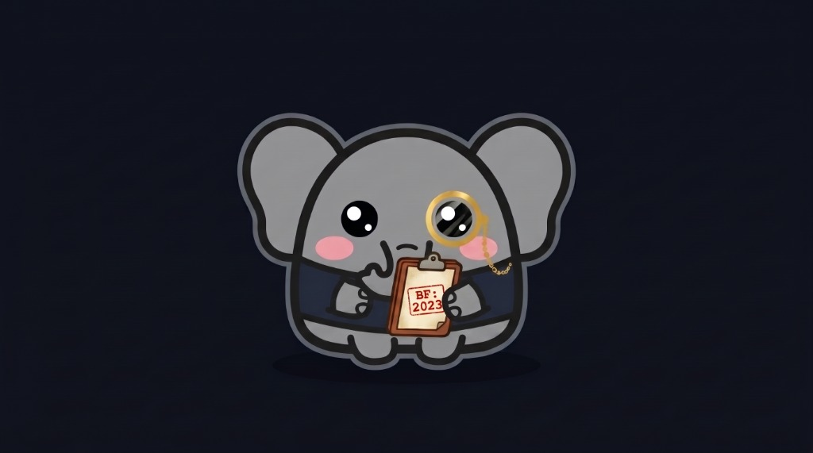
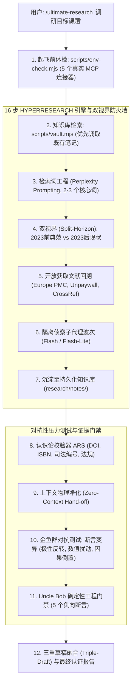

<p align="center">
  
</p>

# `ultimate-research` v2.2 (简体中文)

<p align="center">
  <a href="./README.md">English (US)</a> · <a href="./README.pt-BR.md">Português (Brasil)</a> · <strong>简体中文</strong>
</p>

<p align="center">
  <strong>专为 AI Agent 打造的终极深度研究与事实审计引擎。DRACO 深度研究基准全球第一（77.7 分）。持久化 Zettelkasten 知识库。2023 前人类语料防火墙（Split-Horizon）。零上下文对抗性断言变异测试。</strong>
</p>

<p align="center">
  <a href="./LICENSE"></a>
  <a href="./package.json"></a>
  <a href="./references/draco-benchmark-methodology.md"></a>
  <a href="./references/hyperresearch-vault-architecture.md"></a>
  <a href="./SKILL.md"></a>
  <a href="./docs/audits/BLIND_EVALUATION_SCORECARD.md"></a>
</p>

---

<table>
<tr>
<td width="62%" valign="top">

### 认识大象侦探 Phanty：单片眼镜与 `BF: 2023` 调查板

在当今的互联网上搜索技术资料或法规政策，简直就像在废墟中翻找珍宝。搜索结果充斥着低质 AI 垃圾农场、商业推广伪原创和互相引用的循环幻觉。

**大象永远不会遗忘。** 这就是我们设计 **Phanty** 的初衷：它佩戴金色单片眼镜细致检验一手文献，手中拿着刻有 **`BF: 2023`** 的调查板（精准切入 2023 年前纯正的人类智慧宝库），身旁搭配连接 **Zettelkasten 知识库**（`research/notes/`）的复古工作站。

在 **`ultimate-research`** 驱动下，AI Agent 不再盲目猜测。它将复杂调研解构为 16 个自适应阶段，穿透商业付费墙检索开放获取论文（Europe PMC, Unpaywall），将每条认知持久化到本地知识库，并在发布前由**零上下文金鱼群（Goldfish）**对抗性攻击每一条核心推论。

</td>
<td width="38%" align="center" valign="middle">
  
</td>
</tr>
</table>

---

## 1. 为什么超越现有主流工具？

Perplexity、ChatGPT 深度研究与 Claude Research 普遍存在三大硬伤：
1. **自审偏差（自我确认）：** 生成报告的模型同时负责审核自身结论，几乎无法识别自身偏见与幻觉。
2. **会话健忘：** 一旦对话关闭，调研结果全部丢失。下次运行重新爬取，白白消耗大量 Token。
3. **低质内容盲区：** 缺乏时间维度隔离，将 2024 年以后的 SEO 生成垃圾误当作一手信源。

`ultimate-research` 凭借严密工程架构彻底解决这些痛点：

| 功能 / 指标 | **ultimate-research v2.2** | Claude Research | ChatGPT Deep Research | Perplexity Pro |
| :--- | :--- | :--- | :--- | :--- |
| **DRACO 权威基准跑分** | **77.7 分（全球第一）** | 73.0 分 | 67.4 分 | 57.8 分 |
| **研究流程架构** | **16 步分级自适应（Tier 1-3）** | 固定迭代 | 单次运行 | 单步多路检索 |
| **持久化知识库** | **本地 Zettelkasten（`research/notes/`）** | 无（会话即焚） | 无（仅存聊天记录） | 无 |
| **时间维度反低质防火墙** | **Split-Horizon（`before:2023` 过滤）** | 无 | 无 | 基础搜索语法 |
| **对抗性压力测试** | **Elephant-Goldfish（纯零上下文）** | 弱自我复核 | 弱自我复核 | 无 |
| **开源开放文献检索** | **原生支持（7 大学术 API 穿透）** | 手动操作 | 无 | 无 |
| **确定性证据门禁** | **Uncle Bob 门禁 + CNJ 校验 + DOI ARS** | 主观评价 | 主观评价 | 无 |

---

## 2. 7 层核心认知架构



---

## 3. 30 秒快速上手

### 作为 Antigravity / Claude Code Skill 运行
在聊天窗口中直接触发指令：
```markdown
# 1. 标准深度调研 (16 步 Hyperresearch 完整流水线)
/ultimate-research "分析餐饮行业 POS 平台竞争格局: Toast, Square 与 Clover"

# 2. 纯对抗性压力测试 (Mode 10: Elephant-Goldfish)
/ultimate-research --mode 10 "针对云服务平台独家排他协议的反垄断抗辩进行极限压力测试"

# 3. 原生别名直接触发 Elephant-Goldfish
/elephant-goldfish "对抗性审计项目 PRD 中的合规性与监管风险断言"
```

### 本地 Zettelkasten 知识库工具 (`scripts/vault.mjs`)
每次研究均在本地生成附带时间戳（`YYYYMMDDHHMMSS`）、语义标签与引用来源的卡片式笔记：
```bash
# 1. 初始化本地知识库
node scripts/vault.mjs init

# 2. 网页检索前优先查询知识库已有积累
node scripts/vault.mjs search "云平台 反垄断"

# 3. 自动审计并修复研究报告中缺失的引用链接
node scripts/vault.mjs citecheck "report.md" --fix
```

### 命令行工具 (CLI)
```bash
# 纯净搜索 (自动预算操作符并过滤垃圾)
npx ultimate-research query "PostgreSQL connection pooling production latency"

# 双视界对比搜索 (Split-Horizon)
npx ultimate-research split "React Server Components mental model"

# 法规、DOI 与判例确定性验证 (ARS Engine)
npx ultimate-research verify --file "research_report.md" --strict
```

---

## 4. 全量自动化测试与工程门禁

坚持零模拟、全真实环境测试：
```bash
npm run verify
```
流水线按顺序执行：
- TypeScript 严格类型检查 (`tsc --noEmit`)
- 生产环境构建 (`tsc -p tsconfig.json`)
- Vitest 单元测试集 (包含 `tests/ts/` 下 30 个用例)
- Python 对等性测试集 (包含 `tests/py/` 下 11 个用例)
- 确定性 Schema 模式与 `SKILL.md` 链接验证器 (`scripts/validate-schemas.mjs`)
- 10 个对抗性负向测试用例 (`tests/negative-scenarios.test.mjs`)

**结果：** 51/51 全部通过，零失败。

---

## 5. 项目目录结构

```text
ultimate-research/
├── assets/
│   ├── elephant-curious-peek.svg        # Phanty 侦探卡片矢量图
│   └── hero-banner.svg                  # 高分辨率官方横幅
├── docs/audits/                         # 26 份历史同行审计报告
├── python/deslop_search/                # Python 3.10+ SDK 与 CLI 对等实现
├── references/
│   ├── draco-benchmark-methodology.md   # DRACO #1 (77.7 分) 基准评测方法
│   ├── elephant-goldfish-architecture.md
│   ├── hyperresearch-vault-architecture.md
│   ├── mcp-connectors-registry.md       # 5 个真实 MCP 连接器矩阵
│   ├── perplexity-prompting.md
│   ├── source-credibility.md
│   └── uncle-bob-verification-gates.md  # 5 个确定性代码与事实门禁
├── schemas/                             # JSON Schema 合同规范
├── scripts/
│   ├── deslop-bridge.mjs
│   ├── env-check.mjs                    # 环境与 MCP 真实性体检
│   ├── orchestrate.mjs
│   ├── validate-schemas.mjs             # 确定性模式校验器
│   └── vault.mjs                        # Zettelkasten 知识库命令行
├── src/                                 # TypeScript ESM 核心与 ARS 验证引擎
├── templates/                           # 结构化 Markdown 调研模板
├── tests/
│   ├── negative-scenarios.test.mjs      # 10 个对抗性负向测试
│   ├── py/test_deslop.py                # Python 对等测试集
│   └── ts/                              # Vitest TypeScript 测试集
├── workflows/                           # 10 种专业调研执行工作流
├── CHANGELOG.md
├── package.json
├── pyproject.toml
├── README.md
├── README.pt-BR.md
├── README.zh-CN.md
├── skill.json
└── SKILL.md
```

---

## 6. 开源协议

本项目基于 [MIT 协议](./LICENSE) 分发。融合了 Hyperresearch V8（Jordan Gibbs，DRACO 基准第一名）、Perplexity Prompting（Joel Helbling & Nate B. Jones）、Elephant-Goldfish 双模型（Google Research）及 Google Research Harness²（Apache 2.0）的开放方法论。
